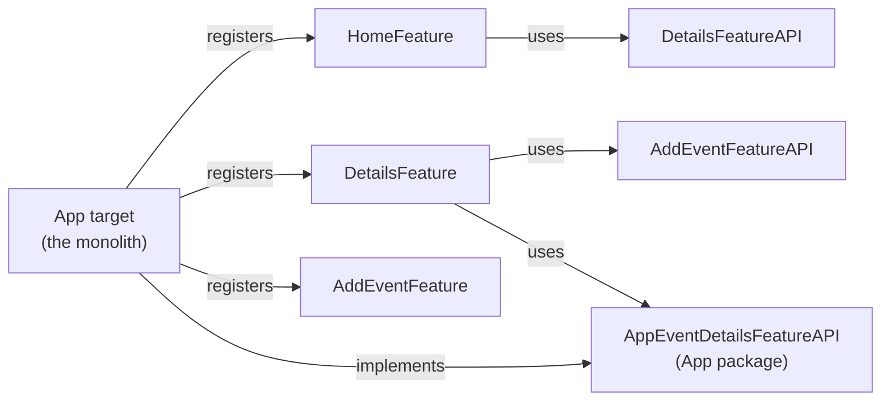
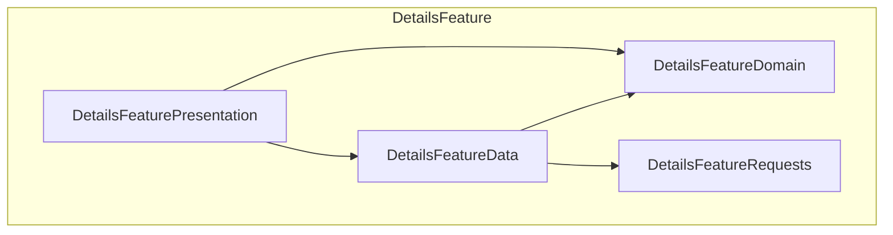

# FeatureModulesExampleApp

Sample app for the article **"Assembling little building blocks into a functioning banking app"**. It shows how features are split into Swift packages and how they talk to each other, without ever compiling each other's implementation.

It reuses the domain of [UnownedCoordinatorExampleApp](https://github.com/swissquote/UnownedCoordinatorExampleApp): Swiss cities, their events, and a modal to add one. Coordinators follow the same UnownedCoordinator model: views own their coordinators.

## Run it

Open `FeatureModulesExampleApp.xcodeproj` (Xcode 26+), select the `ExampleApp` scheme and run. `⌘U` runs the `FeatureModulesExampleApp` test plan, with every layer's test target.

## How the features use each other



| Feature | Kind | Uses |
|---|---|---|
| AddEvent | Standalone | nothing |
| Details | Consumer | AddEvent, EventDetails (through the App package) |
| Home | Consumer | Details |
| EventDetails | Not modularised yet | lives in the app target |

## Where to look

| Article section | In this repo |
|---|---|
| Internal anatomy of a feature | `Features/Details/Package.swift`: one target per layer (`Requests`, `Domain`, `Data`, `Presentation`) and one test target per layer |
| Common packages | `Common/Domain` (shared `City` and `Event`), `Common/Navigation`, `Common/ModuleLoader` |
| How features talk to each other | `Features/*/Sources/API` (protocols only) and `Features/*/Sources/<Name>/<Name>FeatureModule.swift` (hidden implementation) |
| Dependency injection | `Common/ModuleLoader` (`CommonModuleLoader`, `@YuhFeature`), registrations in `App/AppDelegate.swift`, usage in `HomeCoordinator` and `DetailsCoordinator` |
| What if the App itself was a temporary feature? | `Features/App` (API-only package) and `App/AppDelegate+AppEventDetailsFeatureAPI.swift` |
| Testing each block | `FeatureModulesExampleApp.xctestplan` |

## Layers inside a feature



A layer only exists when a feature needs it. AddEvent doesn't fetch or store anything, so it has no Requests or Data layer.

## Building a feature on its own

Each feature package builds without the other features' implementations:

```sh
cd Features/Details
xcodebuild -scheme DetailsFeature -destination 'generic/platform=iOS Simulator' build
```

The build output only contains `AddEventFeatureAPI` and `AppFeatureAPI` from the other features, never `AddEventFeature` itself.

## Moving EventDetails out of the monolith

1. Create `Features/EventDetails` with the same layers.
2. Move `AppEventDetailsFeatureAPI` there and rename it to `EventDetailsFeatureAPI`.
3. Register `EventDetailsFeatureModule()` in `AppDelegate`, instead of `self`.
4. In `DetailsCoordinator`, only the protocol name changes.
